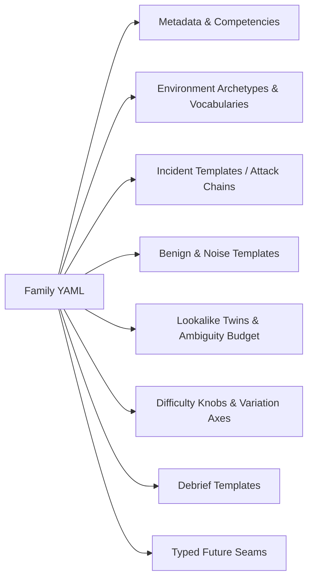
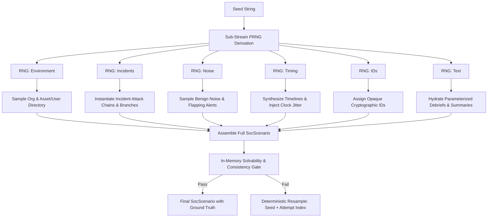
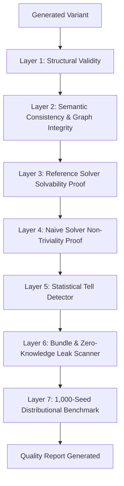

# SOC Scenario Generation System: Design Brief & Architecture

**Document:** `docs/design/soc-generator.md`  
**Status:** Approved for Implementation (Phase 3 Foundation)  
**Date:** 2026-10-13  
**Author:** Staff Security Operations & Procedural Generation Engineer  
**Scope:** Declarative Family Authoring Format, Seeded Deterministic Variant Generator, Solvability & Non-Triviality Proof Toolchain, and Anti-Tell Verification.

---

## 1. Executive Summary & Purpose

In CyberBLADE Phase 3, learners prepare for hands-on SOC certifications (SAL1, SAL2, BTL1, CDSA, CySA+) by triaging realistic enterprise alert queues. A single static scenario allows answer memorization and walkthrough sharing. 

The **SOC Scenario Generation System** solves this by separating **Scenario Families** (declarative blueprints of attack patterns, benign noise, and environmental archetypes) from **Concrete Scenario Variants** (fully instantiated, solvable, deterministic shifts).

### Core Invariants
1. **Strict Determinism**: Variant generation is a pure mathematical function:
   $$\text{Variant} = f(\text{familyId}, \text{familyVersion}, \text{generatorVersion}, \text{seed}, \text{difficulty})$$
   Given identical inputs, the system produces byte-identical scenario models across any OS, Node.js runtime, or execution environment forever.
2. **Zero-Knowledge Ground Truth**: Ground-truth dispositions, incident root causes, acceptable alternatives, and debrief text are generated server-side. The browser receives only the projected client view (`toClientView()`).
3. **Mathematically Proven Solvability & Non-Triviality**: Every family is verified by an automated **Reference Solver** that proves every generated variant is solvable using only learner-visible telemetry, while **Naive Solvers** (e.g., Always Escalate, Trust Severity) prove no heuristic shortcuts can pass.
4. **Statistical Anti-Tell Guarantees**: An automated classifier proves that malicious alerts cannot be separated from benign noise by surface tells (string lengths, field presence, casing, timestamp precision, or ID formats).
5. **100% Original Synthetic Realism**: Telemetry strictly uses RFC private addresses (`10.x`), documentation ranges (`192.0.2.0/24`, `198.51.100.0/24`, `203.0.113.0/24`), reserved domains (`.corp.internal`, `.example`), and synthetic entity vocabularies.

---

## 2. The Family Model (Declarative Blueprint)

A **Family** defines *how* to generate scenarios, not a single static scenario.

### 2.1 File Format Choice: Declarative YAML with Strict Zod Validation
The authoring format is YAML (`content/soc/families/<family-id>.yaml`).
- **Why YAML over TypeScript-with-Zod for authoring?** Non-programmer SOC practitioners and detection engineers must author and review templates without TypeScript build chains.
- **Why Zod for validation?** The generator parses YAML directly into strict Zod schemas (`SocFamilySchema`), guaranteeing runtime type safety and instantaneous validation in CLI tools and CI.

### 2.2 Family Components


1. **Metadata**: Family ID, semver version, display title, operational level (`L1`, `L2`, `L3`), skills tested (`content/soc/skills.yaml`), estimated minutes, author, and practitioner review status (`draft` | `practitioner-reviewed` | `approved`).
2. **Environment Archetypes**: Organization templates sampled from `content/soc/vocab/` (company profiles, industry sectors, network zones, host naming schemes, asset role distribution, and employee user pools with risk ratings).
3. **Incident Templates (Attack Chains)**: Multi-stage adversary operations:
   - Ordered stages (e.g., Phishing Link -> Archive Download -> Credential Replay -> Inbox Rule -> Exfiltration).
   - Parameterized IOCs (IPs, domains, hashes, process trees).
   - Timing offsets with configurable jitter.
   - Branching stages (e.g., EDR blocks vs. adversary bypass).
   - Deliberate detection gaps (e.g., EDR sensor offline for 10 minutes, forcing network correlation).
   - Ground-truth contribution: Minimum evidence set required for conclusion, root cause explanation, and acceptable alternatives.
4. **Benign / Noise Templates**: Enterprise operational background:
   - Automated backups, cron maintenance, SCCM/MDM patches, authorized vulnerability scanning, developer staging deployments, admin PowerShell tasks.
   - Frequency distributions and temporal patterns (business hours bias vs. maintenance batch windows).
5. **Lookalike "Twin" Templates**: Deliberate cognitive tests pairing malicious techniques with authorized equivalents:
   - *Example:* `certutil.exe -urlcache` executed by adversary vs. automated corporate root certificate updater.
   - *Example:* Rapid port sweep by adversary vs. scheduled Tenable/Nessus vulnerability scan.
   - Declared ambiguity budget with acceptable alternative dispositions and score multipliers.
6. **Variation Axes**:
   - Incident count range (`minIncidents` .. `maxIncidents`).
   - Noise ratio range (target 70%–85%).
   - Ambiguity count range (1–4 alerts).
   - Evidence spread (minimum distinct log sources required to resolve).
   - Alert fatigue factor (total alerts generated: 30 to 80+).
7. **Debrief Templates**: Modular, parameterized markdown templates explaining *why* an alert was malicious/benign, highlighting decisive evidence, and modeling senior analyst reasoning.
8. **Future Seams**: Typed placeholders for enrichment datasets, SIEM query pools, evidence views, and report rubrics.

---

## 3. Generator Pipeline Architecture

Generation is pure CPU, zero network, zero filesystem I/O, and strictly bounded to $<150\text{ ms}$.



### 3.1 Sub-Stream PRNG Isolation
To prevent the "butterfly effect" (where altering a noise template alters the entire attack chain), the master seed derives isolated sub-stream seeds using HMAC-like key derivation:
```typescript
const envRng = createRng(`${seed}:environment`);
const incRng = createRng(`${seed}:incidents`);
const noiseRng = createRng(`${seed}:noise`);
const timeRng = createRng(`${seed}:timing`);
const idRng = createRng(`${seed}:ids`);
const textRng = createRng(`${seed}:text`);
```

### 3.2 Timeline & Identity Realism
- **Cross-Source Identity Consistency**: When a user or host is selected for an incident, their host name, IP address, MAC, operating system, and domain credentials match across Email Gateway, EDR, Network IDS, Firewall, and Authentication logs.
- **Clock Jitter**: Realistic clock skew ($\pm 1.5\text{s}$) is injected across independent sensor sources while preserving causal ordering (e.g., DNS lookup must precede TCP SYN).
- **Tool Miscalibration**: Detection rules mimic real SIEM/EDR quirks (e.g., low-severity alerts triggering on high-impact attacks; critical-severity alerts triggering on routine backup spikes).

### 3.3 Opaque Identifiers
IDs are generated via Fisher-Yates shuffled alphanumeric pools:
- Alerts: `alt-<opaque-hex>` (e.g., `alt-7f2a`)
- Events: `evt-<opaque-hex>` (e.g., `evt-3c91`)
- Alerts are ordered strictly by arrival timestamp, **never** by generation sequence or disposition.

---

## 4. Anti-Tell Design & Realism Guarantees

Tells allow learners to "game" procedural generation instead of learning security analysis. The generator enforces strict invariance rules:

| Potential Tell | Cheater Heuristic | Generator Defense |
|:---|:---|:---|
| **Field Asymmetry** | Malicious alerts have extra raw fields or missing telemetry. | Both benign noise and malicious events use identical schema definitions and field templates. |
| **String Length / Vocabulary** | Malicious commands are longer or use weird characters. | Benign admin scripts and updater processes are authored with equivalent length, complexity, and flag density. |
| **Timestamp Precision** | Malicious events have millisecond precision; noise has whole seconds. | Normalized timestamp formatter applied universally across all sources. |
| **ID Sequencing** | True positives generated together have adjacent numerical IDs. | Opaque IDs drawn from a pre-shuffled pool and sorted purely by simulated timestamp. |
| **Position in Queue** | Incidents always appear clustered at the beginning or end of shift. | Attack stages are scheduled across shift hours with stochastic business-hours background noise. |

---

## 5. Validation and Proof Toolchain

The validation toolchain is the core quality assurance engine:



### Layer 1: Structural Validity
- Validates against `SocScenarioSchema` via Zod.
- Enforces RFC documentation IPs (`192.0.2.0/24`, `198.51.100.0/24`, `203.0.113.0/24`, `10.0.0.0/8`) and reserved domains (`.example`, `.corp.internal`).
- Enforces unique alert/event IDs and monotonic timeline ordering.

### Layer 2: Semantic Consistency
- Every alert in `incident.truePositiveAlertIds` exists and matches `disposition === 'true_positive'`.
- Every benign true positive has discoverable authorization evidence (e.g., approved change ticket, known service principal).
- Every false positive has discoverable contradicting evidence (e.g., known vendor hash, authorized scanner host).
- IOC collision check: No benign alert shares an IOC with a concurrent incident unless explicitly part of a declared twin template.

### Layer 3: Solvability Proof (Reference Solver)
Each family defines a deterministic **Reference Solver**:
- Consumes **only** `toClientView(variant)` (zero access to ground truth).
- Executes systematic analyst heuristics (correlating host events, checking asset criticality, inspecting parent processes, identifying known twins).
- Must achieve $\ge 85\%$ accuracy across all seeds. Any seed scoring below $85\%$ triggers an automated build failure.

### Layer 4: Non-Triviality Proof (Naive Solvers)
The variant is evaluated against five deliberately naive heuristics:
1. *Always Escalate*: Every alert escalated as Critical True Positive.
2. *Always Dismiss*: Every alert closed as False Positive.
3. *Trust Tool Severity*: Critical/High escalated; Medium/Low dismissed.
4. *Keyword Matcher*: Heuristic regex matching "malicious", "attack", "exploit".
5. *Random Guesser*: Uniform random selection.

**Requirement**: No naive solver may exceed a $45\%$ score ceiling, and the gap between Reference Solver and the best naive solver must exceed **$40$ percentage points**.

### Layer 5: Tell Detection (Statistical Classifier)
Trains single-feature decision stumps over client-visible fields (command line length, raw field key count, timestamp second distribution, source distribution). If any single feature separates True Positives from noise with $>65\%$ accuracy (above the base rate), the family check fails with the exact leaking feature reported.

### Layer 6: Leak Scans
- Validates that `JSON.stringify(toClientView(variant))` contains zero instances of `groundTruth`, `correctDisposition`, `incidentId`, `acceptableAlternatives`, `debrief`, or generator internal parameters.
- Scans client-visible text for natural language giveaway words (e.g., "malware", "adversary", "exploit", "c2" in rule descriptions for benign alerts).

### Layer 7: Distributional Checks (1,000 Seeds)
- Evaluates 1,000 seeds per family.
- Generates histograms for incident count, noise ratio, ambiguity count, alert volume.
- Asserts zero degenerate variants (empty queues, zero true positives, 100% noise).
- Computes pairwise **Variant Distance Metric** across 1,000 seeds.

---

## 6. Variant Distance Metric

To prevent answer memorization across retakes, the distance metric $D(V_1, V_2)$ between two variants of the same family is defined as:
$$D(V_1, V_2) = 0.35 \cdot J_{\text{IOC}} + 0.30 \cdot J_{\text{Assets}} + 0.20 \cdot J_{\text{IncidentChains}} + 0.15 \cdot \Delta_{\text{Timeline}}$$
Where $J$ is the Jaccard distance between entity sets.
- **Enforcement**: Any two consecutive attempts by the same learner must have $D(V_1, V_2) \ge 0.70$.

---

## 7. Versioning, Immutability & Attempt Lifecycle

### Versioning Policy
- Families are versioned as integers (`1`, `2`, `3`).
- Generator engine version is tracked as integer (`1`).
- Published family versions are **strictly immutable**. When published, the SHA-256 hash of the family YAML is pinned in `content/soc/manifest.json`.
- CI fails if any published family file changes without a corresponding version bump.

### Attempt State Machine
1. **Start Attempt**:
   - Server draws a cryptographic seed using CSPRNG (`newSeed()`).
   - Generates `variant = generateSocVariant(family, familyVer, genVer, seed, difficulty)`.
   - Computes `scenarioHash = sha256(variant)`.
   - Records `(attempt_id, family_id, family_version, generator_version, seed, difficulty, scenario_hash)` in database.
   - Returns `toClientView(variant)`.
2. **Resume Attempt**:
   - Reads attempt parameters from database.
   - Regenerates variant deterministically from `(family_id, family_version, generator_version, seed, difficulty)`.
   - Asserts `sha256(variant) === stored_scenario_hash`. If mismatch, halts with security alert.
3. **Submit Attempt**:
   - Regenerates authoritative ground truth on server.
   - Evaluates learner decisions using pure `evaluateSocAttempt`.
   - Returns scorecard with debriefs **only** for triaged alerts.

---

## 8. Threat Model & Countermeasures

| Threat Vector | Attack Strategy | Architectural Countermeasure |
|:--- |:--- |:--- |
| **Answer Sharing Across Learners** | Learner A posts answers to Discord/Reddit. Learner B tries to apply them. | Each attempt receives an independent seed. The Variant Distance ensures zero overlap in IOCs, affected assets, and timeline sequence. |
| **Seed Prediction / Enumeration** | Learner tries to guess seeds based on timestamp or sequential IDs. | Seeds are generated via `crypto.getRandomValues(8 bytes)` (64-bit entropy). Stored in database column inaccessible to client roles. |
| **Client-Side Derivation** | Learner decompiles frontend bundle to find generator logic or family blueprints. | Generator and family YAML files are strictly server-side (`import "server-only"`). Never bundled or imported into client components. |
| **Heuristic Gaming (Tells)** | Learner notices that true positives always have long commands or specific flags. | Automated Layer 5 Tell Detector catches and blocks surface heuristics before a family can be published. |
| **Replay of Old Attempt Data** | Learner replays old submission payloads. | Attempt state transitions are one-way (`in_progress` $\rightarrow$ `submitted`). Content hash validation prevents tampering. |

---

## 9. Next Steps (Implementation Order)

1. **Part B**: Define `SocFamilySchema` in `lib/lab-engine/soc/family-schema.ts` and author synthetic vocabularies in `content/soc/vocab/`.
2. **Part C**: Build the deterministic generator `lib/lab-engine/soc/generator.ts` with sub-stream PRNG routing and anti-tell shaping.
3. **Part D**: Implement the 7-layer validation and proof toolchain (`lib/lab-engine/soc/family-validator.ts` and solvers).
4. **Part E**: Port the demo scenario into reference family `content/soc/families/soc-f-mixed-signal-01.yaml`.
5. **Part F**: Implement database migrations, server actions, and CLI tools (`soc:gen`, `soc:family-report`, `check:soc:families`).
6. **Part G**: Author documentation for authors and SOC practitioner reviewers.
7. **Part H**: Test suite verification, 1,000-seed benchmarks, and quality gate passes.
