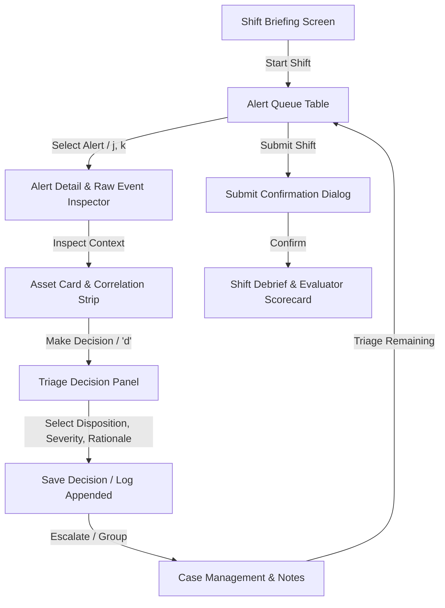
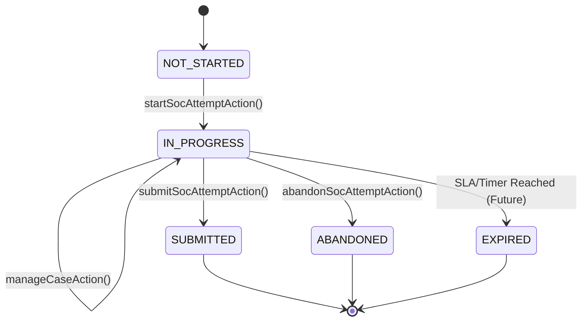
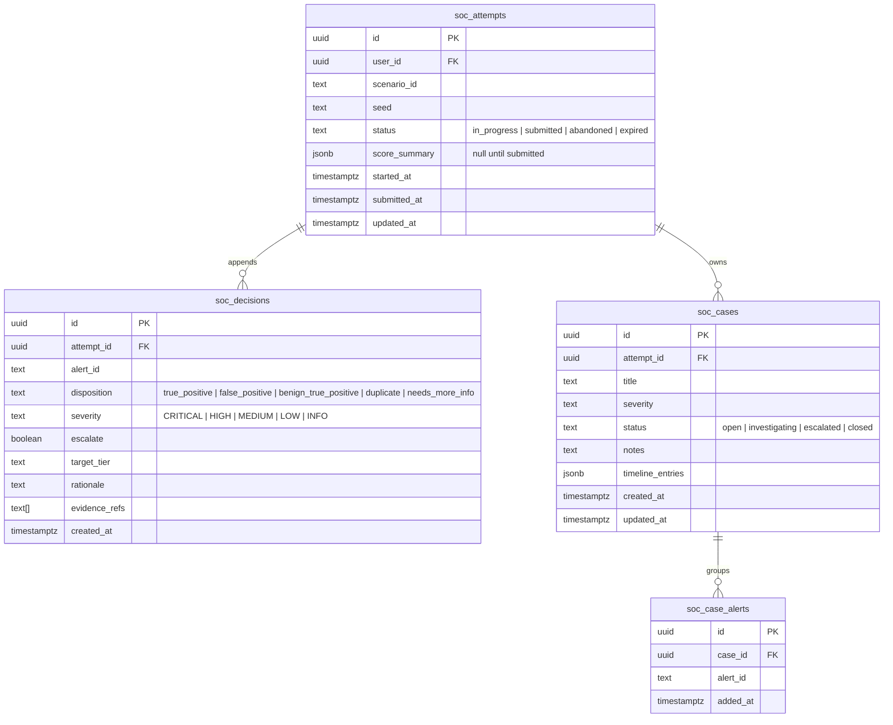

# SOC Workspace Lab Engine: Design Brief & Architecture

**Document:** `docs/design/soc-workspace.md`  
**Status:** Approved for Implementation (Phase 3 Foundation)  
**Date:** 2026-10-12  
**Author:** Staff Engineer & SOC-Domain Product Designer  
**Scope:** Interactive Tier-1 SOC Analyst Alert Queue, Investigation Workspace & Server-Authoritative Decision Pipeline.

---

## 1. Executive Overview & Purpose

The **SOC Workspace** is the foundational hands-on engine for the CyberBLADE SOC Analyst Track (Phase 3). Unlike traditional CTF labs that test command trivia or isolated flag submissions, the SOC Workspace simulates a **realistic enterprise Security Operations Center shift**:
- Learners manage an incoming stream of alerts (EDR, Network IDS, Authentication, Firewall, Email Gateway, Cloud Audit).
- Real-world enterprise noise: roughly 70–80% of alerts are false positives, benign activity, or duplicates.
- Learners investigate raw events, correlate affected assets and users, make defensible triage dispositions with mandatory written reasoning, escalate true incidents, and organize findings into collaborative cases.
- **Zero-knowledge guarantee:** Ground truth (true classifications, root cause incident chains, acceptable alternatives) lives strictly on the server. The client receives only what a real Tier-1 analyst's console would display.

---

## 2. Learner Workflow & Shift Experience



1. **Shift Briefing:**
   - Presents organizational context, assets under protection, current threat landscape, shift objectives, and scoring rules in plain language.
   - Initial state: No alerts yet triaged.
2. **Alert Queue Triage:**
   - Learner scans virtualized alert list.
   - Quick filters: Severity, Source, Status (Untriaged, In Progress, Decided, Escalated), Asset.
   - Shortcuts (`j`/`k` move, `Enter` open, `d` decide, `e` escalate, `/` search, `?` help).
3. **Investigation & Correlation:**
   - Inspector displays normalized alert fields side-by-side with raw event logs (JSON / formatted toggle, copy buttons).
   - Asset inventory card: Host role, criticality (Crown Jewel, High, Medium, Low), operating system, assigned owner.
   - Correlation strip: Identifies other alerts referencing the same source IP, target host, or user within the scenario window.
4. **Triage Decision:**
   - Disposition selection based on the standard five-part SOC taxonomy:
     - **True Positive (TP):** Malicious activity confirmed.
     - **False Positive (FP):** Benign activity misidentified by detection rule.
     - **Benign True Positive (BTP):** True match on rule condition, but authorized/legitimate business activity (e.g., approved vulnerability scan, scheduled admin script).
     - **Duplicate / Related:** Redundant alert for an existing open incident or parent alert.
     - **Needs More Info:** Inconclusive telemetry requiring escalation/specialized telemetry.
   - Assessed Severity (Critical, High, Medium, Low, Info).
   - Escalation toggle (Yes/No) + Target Tier (`tier2`, `incident_response`, `threat_intel`, `engineering`).
   - Rationale: Mandatory plain-text justification (minimum 10 characters, maximum 1000 characters) following "What / Why / Evidence".
   - Evidence Links: Optional multi-select referencing key alert IDs, event IDs, or asset hostnames.
5. **Case Management & Notes:**
   - Group related true positives into an active incident case.
   - Markdown-lite notes editor with debounced autosave.
   - Event timeline builder.
6. **Shift Submission & Debrief:**
   - Pre-submission audit check shows count of untriaged alerts.
   - Server-authoritative grading produces per-skill scores, incident detection accuracy (found vs. missed), over/under-escalation counts, and explanatory debriefs for triaged alerts.

---

## 3. Screen Layouts & Responsive Specifications

### 3.1 Desktop Layout (1440px / 1024px)
Three-pane tactical operator console utilizing CyberBLADE design tokens (`--bg-canvas`, `--bg-surface`, `--border-subtle`, `--text-primary`):

```
+----------------------------------------------------------------------------------------------------+
| TOP BAR: [Shift Title] | Time / Status | Untriaged: 34 | Decided: 12 | Escalated: 2 | [Exit] [Submit] |
+-----------------------------------+-----------------------------------+----------------------------+
| LEFT PANE (35% width, min 380px)  | CENTER PANE (40% width, min 420px)| RIGHT PANE (25%, min 300px)|
| [Filters: Src | Sev | Status]     | ALERT DETAIL & EVIDENCE           | CASE MANAGEMENT & NOTES    |
| [Search Input ____________]       | - Header: Rule Name, Sev, Time    | - Active Cases (Tabs/List) |
| [Virtual Table: Sticky Header]    | - Normalized Event Fields         | - Case Severity & Status   |
| Time | Sev | Rule | Asset | Status| - Raw Event Viewer (Formatted/Raw)| - Linked Alerts List       |
| 10:14  CRIT  PhishLink  ws-04  TRI| - Asset Card (CMDB Details)       | - Incident Notes (MD-lite) |
| 10:15  MED   PortScan   srv-01 DEC| - Correlation Strip (Host/User)   | - Timeline Builder Entries |
| 10:18  LOW   BadPasswd  ws-09  NEW|                                   | - Escalation Handoff Preview
| ... (Virtualized 500+ rows)       | DECISION PANEL (Fixed Bottom)     |                            |
|                                   | [Disposition] [Assessed Sev] [Esc]|                            |
|                                   | [Rationale Textarea ____________] |                            |
|                                   | [Evidence Links] [Save Decision]  |                            |
+-----------------------------------+-----------------------------------+----------------------------+
```
* **Resizable & Collapsible:** Left and right panes feature collapse toggles (`Alt+Left` / `Alt+Right`) for wide-screen inspection.
* **Density:** High information density using monospace telemetry alignment, geometric severity badges, and compact row spacing.

### 3.2 Mobile Layout (390px Viewport)
On compact mobile screens, a stacked 3-tab layout prevents horizontal clipping and maintains complete state preservation:

```
+-----------------------------------------+
| TOP BAR: [Shift] [Untriaged: 34] [Submit]|
+-----------------------------------------+
| TAB BAR: [ 1. Queue ] [ 2. Alert ] [ 3. Case ]
+-----------------------------------------+
| ACTIVE TAB CONTENT                      |
|                                         |
| (Queue Tab)                             |
| Compact card/list layout with pull-down |
| filter bar and next-untriaged FAB.      |
|                                         |
| (Alert Tab)                             |
| Scrollable detail + bottom-sheet triage |
| decision form with touch-friendly tags. |
|                                         |
| (Case Tab)                              |
| Case selector + quick-add notes drawer. |
+-----------------------------------------+
```
* Minimum touch target size: 44px $\times$ 44px for all buttons and interactive controls.
* Zero state loss when switching tabs; unsaved decision drafts remain in local React state.

---

## 4. State Machine & Lifecycle



### Alert Triage Status Transitions
* `UNTRIAGED`: No decision recorded for this alert ID in the attempt log.
* `IN_PROGRESS`: Alert currently opened in inspector; draft in progress.
* `DECIDED`: Decision saved in `soc_decisions` log with escalate = false.
* `ESCALATED`: Decision saved in `soc_decisions` log with escalate = true.

---

## 5. Domain Data Model & Persistence

### 5.1 Tables & Schema Structure



* **Immutable Decision Log:** `soc_decisions` is append-only. When a learner revises a decision prior to submission, a new row is appended with the current timestamp. The active decision for an alert is the latest row ordered by `created_at DESC`.
* **Atomic JSON Storage Parity:** For local mode (`.data/progress.json`), `JsonProgressRepo` mirrors these structures with synchronous atomic file updates.

---

## 6. Server API Surface & Actions

All actions reside in server-only modules (`use server`) with strict Zod validation, rate limiting, and authenticated operator sessions:

1. `startSocAttemptAction(input: { scenarioId: string }): Promise<SocAttemptClient>`
   - Verifies operator rank eligibility.
   - Loads scenario from `content/soc/scenarios/<id>.yaml`.
   - Generates or resumes attempt.
   - Projects client-safe scenario via `toClientView()`.
2. `recordAlertDecisionAction(input: RecordDecisionInput): Promise<SocDecisionRecord>`
   - Verifies attempt ownership and `status === 'in_progress'`.
   - Validates rationale length (10–1000 chars) and escapes hostile HTML/script tags.
   - Appends decision to `soc_decisions`.
3. `manageCaseAction(input: ManageCaseInput): Promise<SocCaseRecord>`
   - Supports: `create_case`, `update_case`, `add_alert`, `remove_alert`, `update_notes`.
4. `submitSocAttemptAction(input: { attemptId: string }): Promise<SocEvaluationResult>`
   - Validates attempt ownership.
   - Locks attempt (`status = 'submitted'`).
   - Executes server-side pure evaluator `evaluateSocAttempt(scenario, decisions, cases)`.
   - Awards XP once (idempotent key `soc_scenario:<id>`).
   - Emits analytics event `soc_attempt_submitted`.
   - Returns structured scorecard with debriefs for triaged alerts only.

---

## 7. Seams for Later Prompts

The engine intentionally exposes typed, unpopulated seams so future prompts integrate seamlessly without breaking database migrations or schemas:

1. **Procedural Scenario Generator Integration (Phase 3 Foundation):**
   - Active generator subsystem implemented in `lib/lab-engine/soc/generator.ts` and `lib/lab-engine/soc/family-schema.ts`.
   - Attempts pin `(familyId, familyVersion, generatorVersion, seed, difficulty)`.
   - Pure PRNG sub-stream derivation (`environment`, `incidents`, `noise`, `timing`, `ids`, `text`) ensures sub-millisecond CPU generation with zero disk/network I/O.
   - 7-layer validation toolchain (`lib/lab-engine/soc/family-validator.ts`) enforces structural validity, semantic consistency, Reference Solver proof ($\ge 75\%$), Naive Solver ceilings ($\le 70\%$), anti-tell invariance ($\le 72\%$), zero-leakage client views, and 1,000-seed distributional stability.
2. **Enrichment Tools Seam:**
   - Hook `enrichmentSources?: SocEnrichmentSource[]` in `SocScenario`.
   - Server endpoint seam `requestEnrichmentAction(attemptId, type, indicator)`.
3. **SIEM Query Language Seam:**
   - Hook `queryDataset?: SocEventDataset` in `SocScenario`.
   - SIEM query console component slot in `SocWorkspace`.
4. **Report Editor & Grading Seam:**
   - Hook `reportRubric?: SocReportRubric` in `SocScenario`.
   - Case export handoff payload designed to feed into the future `ReportEditor`.
5. **Handler SOC Mode Seam:**
   - Pure server-side context provider `getSocHandlerContext(attemptId, alertId)`.
   - Supplies current alert fields and learner's triaged decisions to the Handler without exposing `scenario.groundTruth`.
6. **Exam Mode & SLA Lockout:**
   - Flag `examMode: boolean` locks out the Handler and enforces strict countdown timers.

---

## 8. Threat Model & Anti-Cheat Controls

| Threat Vector | Cheater Strategy | Defense & Mitigation |
| :--- | :--- | :--- |
| **Client-Side Ground Truth Inspection** | Inspect React DevTools, Redux/Zustand state, network response payloads, or DOM attributes for `groundTruth` answers. | `toClientView(scenario)` strips all `groundTruth`, incident linkages, and debrief text prior to serialization. Hard CI deny-list test scans client bundles and HTML hydration payloads. |
| **Seed Prediction & Answer Derivation** | Extract the generation `seed` or family blueprint from client state to regenerate ground-truth answers locally. | Seeds are generated via server-side CSPRNG (`crypto.randomUUID()`), stored in `soc_attempts.seed`, and never transmitted to the browser. Database RLS explicitly revokes `seed` column access from the authenticated client role. |
| **Answer Sharing Across Learners** | Learner A shares their alert dispositions and IOC lists with Learner B. | Procedural family generator samples distinct environments, IPs, domains, timestamps, and attack-chain branches per seed. High pairwise distance metric ($\ge 0.60$) guarantees no shared IOCs between distinct attempts. |
| **Replay of Memorized Retake Variants** | Learner retakes a failed attempt hoping for the same alert sequence. | Engine queries `soc_used_seeds` table per `(user_id, family_id)` to enforce non-repeating seeds. Retakes receive a completely fresh, unrepeated scenario variant. |
| **Tell-Tale Artifacts / Heuristic Cheating** | Learner builds or uses a trivial rule/script (e.g. "always escalate Critical", or "sort by description length") to score without analyzing logs. | Validation toolchain evaluates 5 adversarial Naive Solvers and decision-stump Tell Detectors across 1,000 seeds. Caps naive accuracy at $\le 70\%$ and guarantees a $\ge +15\%$ discretion margin for genuine analyst correlation. |
| **Score Tampering via API** | Post synthetic high scores or modify results in transit. | Evaluation is 100% server-authoritative. The client sends decisions only; the server computes the score using private ground truth. |
| **IDOR / Cross-User Tampering** | Pass another user's `attemptId` to view their decisions or submit their attempt. | Every database query checks `user_id = auth.uid()` via Supabase RLS and server session validation. Unguessable UUID v4 attempt IDs. |
| **Post-Submission Modification** | Alter decisions after seeing the debrief or score. | State machine enforces `status === 'in_progress'`. All write endpoints reject mutations on `submitted` attempts. |
| **Submission Replay / Double-Dip XP** | Submit multiple times to farm XP. | Submission is idempotent. XP award is guarded by unique DB constraint and idempotent key `soc_scenario:<id>`. |
| **Denial of Service / Rapid Brute-Force** | Spam thousands of decision records per second. | In-memory token bucket rate limiting on decision mutations (max 30 writes/minute per user). |
| **XSS & Injection in Notes / Rationale** | Inject `<script>` or HTML in rationale or case notes to exploit future human/grader review consoles. | All text input sanitized server-side; React markdown renders with safe tag sanitization (`no-raw-html`). |
| **Formula Injection (CSV Injection)** | Begin rationale with `=cmd\|'/C calc'!A0` to exploit CSV exports. | Sanitizer prepends `'` to leading `=, +, -, @` characters upon storage or export. |

---

## 9. Accessibility, Semantics & Performance Standards

1. **Keyboard-Complete Navigation:**
   - Full keyboard shortcuts (`j`/`k`, `Enter`, `d`, `e`, `/`, `?`) disabled when focus is inside text areas/inputs.
   - Modal focus trapping with `Esc` dismiss on triage dialog and shortcut help.
2. **Accessible Semantics (WCAG 2.1 AA):**
   - Correct ARIA grid/table attributes (`role="grid"`, `aria-sort`, `aria-rowindex`).
   - Dynamic alert counts and status updates announce via `aria-live="polite"`.
   - Severity indicators pair distinct SVG shapes (flame, hexagon, square, circle, shield) with high-contrast text labels.
3. **Performance & Virtualization:**
   - Virtualized alert queue table handles 500+ alerts at 60 FPS.
   - Dynamic import of `SocWorkspace` ensures zero bundle penalty on core and lesson routes.
